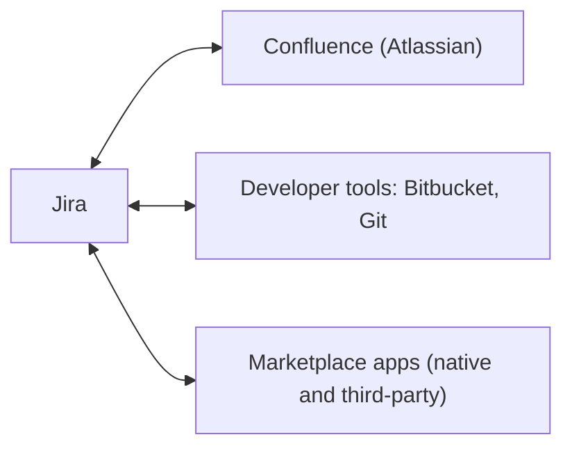

# Welcome to Jira from Zero to Hero

[Course home](../README.md) › [Section 1: Introduction](README.md) › Lesson 1 · 6:38

## TL;DR

Jira is Atlassian's project and work management tool, used by tens of thousands of organizations and especially popular with Agile teams. Most frustration with Jira comes from using it without understanding how it is meant to be set up and run. The course starts from zero and stays hands-on in a free Jira Cloud site. It focuses on what a regular user needs and gives only a light introduction to administration.

## Key concepts

- **Jira**: A project and work management tool made by Atlassian. It is a strong fit for organizations that work in an Agile way or are moving toward one, but it is not limited to them.
- **Jira Cloud**: The hosted version of Jira. Anyone can sign up, and it is free for teams of up to 10 users, which makes it ideal for practice.
- **User vs admin**: The course teaches Jira from a user's point of view. Administration, meaning configuring Jira for a whole organization, is a separate subject. Still, whoever creates a practice site becomes its admin and can experiment with settings freely.
- **Integrations**: Jira is not a standalone tool. It connects to other Atlassian products such as Confluence, to developer tools such as Bitbucket and Git, and to thousands of native and third-party apps from the Atlassian Marketplace.

## What the course covers

- Creating spaces (formerly *projects*) and boards
- Working with Scrum and Kanban boards
- Organizing work with components and release versions
- Finding work items (formerly *issues*) with JQL, the Jira Query Language
- Building dashboards and reading Jira's automated reports
- Automating work without admin rights
- General principles for working with integrations, rather than a tour of individual apps

## Tips and pitfalls

- **Practise each lesson right away**, in your own free site or in your organization's Jira. Skills that are only watched fade quickly.
- **Take care in a shared company Jira.** Avoid changing or deleting other people's work while experimenting. A personal free site is the safe place to try things.
- **Understand before you configure.** Teams that set Jira up without understanding it tend to end up with a tool nobody enjoys using. Knowing how the pieces are meant to fit together prevents that.

## Review questions

Who makes Jira, and what kind of tool is it?

Atlassian. Jira is a project and work management tool, especially popular with Agile teams.

Up to how many users can a Jira Cloud site be used for free?

Up to 10 users. Larger teams need a paid plan.

According to the course, why do many people end up disliking Jira?

They use it without understanding how it is supposed to be set up and managed for their team.

Name three kinds of tools Jira can integrate with.

Other Atlassian products such as Confluence, developer tools such as Bitbucket or Git, and native or third-party apps from the Atlassian Marketplace.

## Related

- [Glossary](../reference/glossary.md)
- [Set Up Your Free Jira Cloud Site (Optional Hands-On Setup)](04-set-up-free-jira-cloud-site.md)
- [Study Plan](../00-start-here/study-plan.md)

---

Previous: [Section overview](README.md) · Next: [What You'll Learn in This Course](02-what-youll-learn.md)
