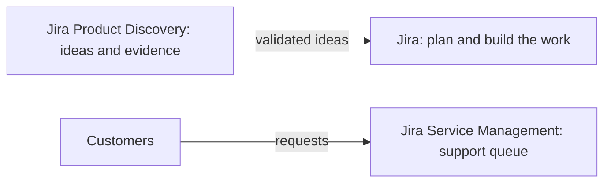

# Jira Has Changed: Products, Terminology & What You Need to Know

[Course home](../README.md) › [Section 1: Introduction](README.md) › Lesson 3 · 8:55

## TL;DR

Jira Software and Jira Work Management have merged into a single product called **Jira**, which can manage almost any kind of work. Jira Service Management is still a separate product, and Jira Product Discovery is a newer one. Several core terms were renamed: projects are now **spaces**, issues are now **work items**, and issue types are now **work types**. The old words still appear in many places, including JQL. The underlying logic of Jira has not changed, so the concepts in the course still apply.

## Key concepts

- **Jira**: The merged product that combines the former Jira Software (built for software development) and Jira Work Management. With templates and workflows for many kinds of teams, such as HR or legal, it now covers general work management too.
- **Jira Service Management (JSM)**: A separate product that connects customers with support and operations teams. Customers submit requests (for example a complaint or a feature request) and receive updates without ever seeing the team's boards or workflows. The team works through the requests in a queue.
- **Jira Product Discovery (JPD)**: A product for the discovery stage of product work. Product managers use it to gather customer evidence, run experiments, and test hypotheses. Validated ideas then become work items in Jira. It is not covered in the course.
- **Jira Cloud**: The version hosted by Atlassian and the focus of the course. It is what most companies use.
- **Jira Data Center**: A self-managed version installed on a company's own servers. It can be customized heavily, and long-lived installations can drift far from Cloud and lack newer Cloud features. Atlassian is retiring it: new customers could no longer buy it after March 30, 2026, and it reaches end of life on March 28, 2029, after which remaining installations become read-only.
- **Rovo**: Atlassian's AI assistant. It is a chat assistant that can answer questions about Jira, such as why a setting is missing or why an action isn't available to a user. It is included in the paid plans (Standard, Premium, Enterprise) and their trials, but not in the Free plan.

## Renamed terms

| Old term | New term | Still seen as the old term in |
|---|---|---|
| Project | Space | JQL (`project = ABC` still works next to the newer `space = ABC`), the API, and parts of the interface |
| Issue | Work item | Many screens, documentation, and apps |
| Issue type (Story, Epic, Task, Subtask, ...) | Work type | Some screens still show *issue type* |

Most of the course was recorded before these renames, so the videos often say *project* and *issue*. Read them as *space* and *work item*. The full mapping is in [Jira terminology changes](../reference/jira-terminology-changes.md).

## Tips and pitfalls

- **Focus on logic, not on the interface.** Atlassian changes the interface often and runs experiments, so two browsers can show different layouts on the same day. Company sites may also be customized. How things work is what stays stable.
- **Expect mixed terminology.** Seeing *project* and *space* on the same screen is normal during the transition.
- **Use Rovo while learning.** Asking the assistant why something is missing or unavailable is a fast way to troubleshoot permissions and settings. On a Free site, start a Standard or Premium trial to try it.

> [!NOTE]
> A company still running Data Center may see a Jira that looks and behaves differently from the course. The concepts still apply, but some Cloud features may be missing. Because Data Center reaches end of life in March 2029, such companies are moving to Cloud, so Cloud skills are the ones worth learning.

## Review questions

Which two products were merged into what is now simply called Jira?

Jira Software and Jira Work Management.

What is the main difference between Jira and Jira Service Management?

Jira is for teams planning and doing work. Jira Service Management lets customers submit requests and get updates without seeing the team's boards or workflows, while support teams handle the requests in a queue.

What are projects, issues, and issue types called now?

Spaces, work items, and work types.

Which word do you use for a space when writing JQL?

project, for example <code>project = ABC</code>. It works on every site and in every existing filter. Atlassian is adding <code>space = ABC</code> as the new name, but it may not work everywhere yet.

How does Jira Data Center differ from Jira Cloud, and what is its future?

Data Center is installed and managed on a company's own servers and can be heavily customized. Cloud is hosted by Atlassian and gets new features first. Atlassian stopped selling Data Center to new customers in March 2026 and ends it in March 2029, so Cloud is the long-term version.

## Related

- [Glossary](../reference/glossary.md)
- [Jira Terminology Changes](../reference/jira-terminology-changes.md)
- [JQL Basics: What is Jira Query Language and Why It Matters](../05-filters-and-jql/03-jql-basics.md)

---

Previous: [What You'll Learn in This Course](02-what-youll-learn.md) · Next: [Set Up Your Free Jira Cloud Site (Optional Hands-On Setup)](04-set-up-free-jira-cloud-site.md)
