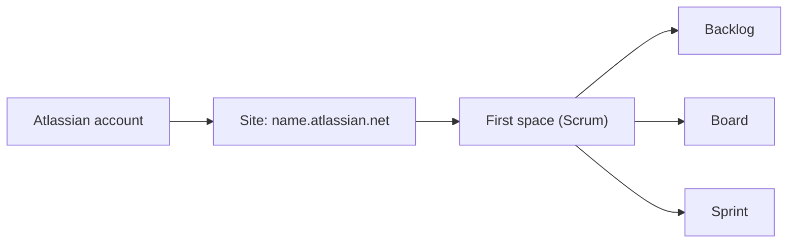

# Set Up Your Free Jira Cloud Site (Optional Hands-On Setup)

[Course home](../README.md) › [Section 1: Introduction](README.md) › Lesson 4 · 7:09

## TL;DR

A free Jira Cloud site takes a few minutes to create and is the safest place to practise. Sign up on Atlassian's website, create a site (your own `name.atlassian.net`), and let the onboarding create a first **Scrum** space, company-managed if that option is offered. The result is a site with a backlog, a board, and a first sprint, ready for the rest of the course.

## Key concepts

- **Site (instance)**: Your own copy of Jira Cloud, reached at `<site-name>.atlassian.net`. An organization normally has one site, usually named after the organization.
- **Free plan**: Jira is free for up to 10 users, with 2 GB of storage and a small monthly allowance of automation rule runs. That covers everything the course needs. Plans and limits change over time, so check the current pricing page before choosing a plan for an organization.
- **Premium trial**: New sites usually get a time-limited trial of the Premium plan, with extras such as the Rovo AI assistant and Plans. When the trial ends and the site returns to Free, those extras disappear.
- **Space template**: The onboarding asks what kind of work you do and suggests a template. The choice only shapes the first space. It doesn't limit the site to Scrum or Kanban.
- **Scrum space**: A space with a backlog, a board, and sprints. It is the setup the course follows.

## How to do it in Jira

1. Go to **atlassian.com/software/jira**. The page design changes often, so look for the equivalent buttons if it looks different.
2. Optional: open **Pricing** to compare the Free, Standard, Premium, and Enterprise plans.
3. Select **Get it free** and sign up, for example with a Google account.
4. Create the **site**. Use the organization's name for a work site; for a personal site any name works. Write it down, because it can't be changed later. Recently Jira has sometimes assigned a site name automatically.
5. Answer the onboarding questions about your work. *Software development* or *Project management* both work for the course.
6. Choose a **Scrum** template. If Jira asks for a space type, choose **company-managed**. If it doesn't ask, carry on; another space can be created later.
7. Give the space a name.
8. Say how familiar you are with Jira. *Not familiar* turns on guided tutorials and pop-ups; *familiar* skips them.
9. Check the result: the browser shows your site address, and the new space already has a backlog and a first sprint. The onboarding tutorial can be collapsed and reopened later.

## Examples

**The course's running example:** the course imagines building *Stamps and Points*, a loyalty app for collecting stamps, points, and rewards. The app has two sides:

- a **vendor site**, where shops, restaurants, and cafes reward customers and see data about them;
- a **customer site**, where people see the stamps and points they have collected.

Later lessons create epics, stories, and boards for this app, so naming your space after it makes the videos easy to follow.

## Tips and pitfalls

- **Pick the site name carefully.** It becomes part of every URL and can't be renamed later.
- **Don't worry if the onboarding looks different.** Atlassian changes these screens often. What matters is ending up with a Scrum space.
- **Practise at work with care.** If you practise in your organization's site instead, avoid changing shared settings or other people's work.

> [!TIP]
> Keep your site URL and login details in a private note, for example in the local-only `_personal/` folder of this repo.

## Review questions

What is a Jira site, and what does its address look like?

A site is your own Jira Cloud instance. Its address looks like name.atlassian.net, and an organization usually has one.

Why does the course recommend creating a Scrum space first?

A Scrum space comes with a backlog, a board, and sprints, which are what the early lessons use.

Does choosing a template during onboarding limit the site to that way of working?

No. It only creates the first space. Other spaces with other templates, such as Kanban, can be added at any time.

Which space type should be chosen if onboarding offers the option?

Company-managed.

## Related

- [Glossary](../reference/glossary.md)
- [Team-Managed vs Company-Managed Spaces](../02-jira-fundamentals/01-team-managed-vs-company-managed-spaces.md)
- [Scrum Workflow in Jira: Sprints, Planning, and Execution](../03-agile-scrum-and-kanban/01-scrum-workflow-sprints.md)

---

Previous: [Jira Has Changed: Products, Terminology & What You Need to Know](03-jira-has-changed.md) · Next: [Navigate Jira: Menus, Spaces & Settings](05-navigate-jira-menus-spaces-settings.md)
