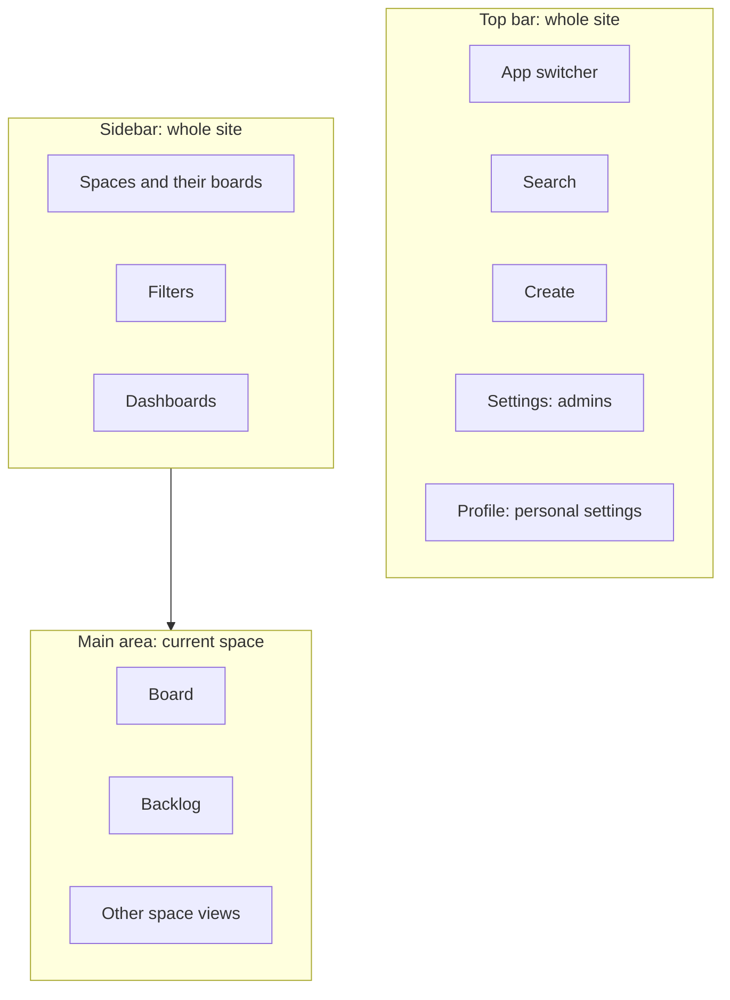

# Navigate Jira: Menus, Spaces & Settings

[Course home](../README.md) › [Section 1: Introduction](README.md) › Lesson 5 · 4:44

## TL;DR

Jira's screen has layers of navigation. The top bar holds the app switcher, search, **Create**, settings, and your profile. The left sidebar reaches site-wide items such as spaces, filters, and dashboards. The main area shows the current space with its own menu, such as board and backlog. Settings behind the gear icon apply to the whole site and are mainly for admins; personal settings sit under your profile.

## Key concepts

- **App switcher**: The Atlassian menu in the top-left corner, used to move between Atlassian apps such as Jira, Confluence, and Trello.
- **Top bar**: The site-wide bar with **Search** (work items, boards, people, spaces), the **Create** button (new work items, formerly *issues*), **Settings**, and your **profile**.
- **Jira settings (gear icon)**: Site-wide administration for spaces, work items, workflows, and more. On a new practice site you are the admin and see everything; on a company site this menu may show little or nothing.
- **Personal settings (profile menu)**: Settings for your own account only.
- **Sidebar**: The left menu for all of Jira. It lists your spaces and the boards inside them, as well as filters and dashboards.
- **Space navigation**: When a space is open, the main area has space-specific views such as **Board** and **Backlog**. Which views appear can be customized.

## How to do it in Jira

1. **Switch apps**: open the app switcher in the top-left corner and pick another Atlassian app.
2. **Find anything**: use the **Search** bar in the top bar for work items, boards, people, and spaces.
3. **Create a work item**: select **Create** in the top bar.
4. **Open site settings**: select the **Settings** (gear) icon. This is where admins manage spaces, work items, and workflows.
5. **Change your own settings**: open your **profile** menu and choose the account or personal settings.
6. **Open a space or board**: pick it under **Spaces** in the sidebar. Boards appear under their space as more are created.
7. **Move between space views**: switch between **Board** and **Backlog** in the space's own menu. If a view is missing, add it through the space's navigation options.

## Tips and pitfalls

- **An empty board is normal at first.** A Scrum board (sometimes called the sprint board) shows only the active sprint, so it is empty until a sprint has started. Plan work in **Backlog** first.
- **Mixed labels are expected.** Some screens say *Project* and others say *Space* for the same thing.
- **Search when lost.** The search bar is the quickest way to reach a work item, board, person, or space.
- **Menus differ by permission.** Missing menu items usually mean missing permissions or views that haven't been added to the navigation, not a broken site.

## Review questions

Where do you switch between Jira, Confluence, and other Atlassian apps?

In the app switcher, the Atlassian menu in the top-left corner.

What is the difference between the settings gear and the profile menu?

The gear opens site-wide Jira settings, which are mainly for admins. The profile menu holds personal settings for your own account.

Why might a freshly created Scrum board look empty?

The board shows the active sprint, and no sprint has been started yet. Work is planned in the backlog first.

What can you find with the search bar?

Work items, boards, people, and spaces.

## Related

- [Glossary](../reference/glossary.md)
- [Jira Terminology Changes](../reference/jira-terminology-changes.md)
- [How Jira Is Structured: Spaces, Boards & Work Items](../02-jira-fundamentals/06-how-jira-is-structured.md)
- [Customizing Your Jira Board View Without Admin Access](../06-boards-and-workflows/01-customizing-board-view.md)

---

Previous: [Set Up Your Free Jira Cloud Site (Optional Hands-On Setup)](04-set-up-free-jira-cloud-site.md) · Next: [Section 1 Quiz](06-section-1-quiz.md)
