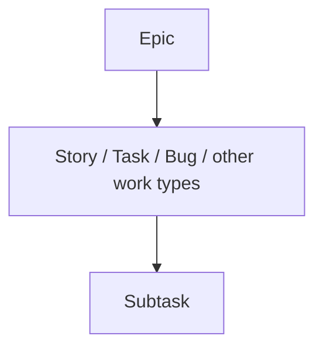

# Understanding Jira Work Types & Hierarchy

[Course home](../README.md) › [Section 2: Jira Fundamentals](README.md) › Lesson 2 · 7:09

## TL;DR

Inside a Jira site you create **spaces** (formerly *projects*), and inside each space you create **work items** (formerly *issues*). Jira's default hierarchy has three levels: **epic** at the top, standard work types such as story, task, and bug in the middle, and **subtask** at the bottom. Each work item has one parent at most, but a parent can have many children. Understanding this structure is essential for planning, reporting, and searching work.

## Key concepts

- **Jira site (instance)**: The whole Jira environment for an organization, usually one per company, at an address such as `name.atlassian.net`. Spaces, people, and work items all live inside it.
- **Space**: A container for related work. It has a name and a key. Teams organize spaces by product, team, feature, or repository, depending on how they work.
- **Work item (formerly *issue*)**: A single trackable unit of work. Older materials and some screens still say *issue* or even *ticket*.
- **Work type (formerly *issue type*)**: The category of a work item, such as Epic, Story, Task, Bug, or Subtask. Spaces can define additional custom work types.
- **Epic**: The highest level in Jira's default hierarchy. Epics group large bodies of work, such as major features or areas of a product.
- **Story**: A work item written from the user's or customer's perspective, usually describing value to be delivered.
- **Bug**: A defect or broken behavior that needs fixing, not new functionality.
- **Task**: General work that must be done but does not directly represent user-facing value, such as procuring a software license.
- **Subtask**: A smaller piece of work nested under a standard work type. Subtasks break a story, task, or bug into concrete steps such as design, coding, or testing.
- **Parent-child relationship**: The built-in hierarchy link. A story belongs to one epic; a subtask belongs to one parent work item. One parent, many children.



## Default hierarchy rules

| Level | Work types | Can be parent of | Can have parent |
|---|---|---|---|
| Top | Epic | Stories, tasks, bugs, other non-subtask types | — |
| Middle | Story, Task, Bug, custom types | Subtasks | One epic |
| Bottom | Subtask | — | One middle-level work item |

- A middle-level work item links to **one epic only**. It cannot belong to two epics at once.
- A subtask links to **one parent** work item. Subtasks do not sit under epics directly.
- **Jira Premium and Enterprise** can add hierarchy levels above epic for large initiatives. The course focuses on the standard three-level model.

## How to do it in Jira

1. Open a space and note its **key** in the sidebar or space settings. Every work item created there will use that prefix.
2. When creating work, pick the **work type** that matches the level: Epic for large themes, Story/Task/Bug for deliverable work, Subtask for breakdown steps.
3. To see hierarchy on an open work item, check the **parent** field or breadcrumb trail at the top of the detail view.
4. In the backlog, enable the **Epics** panel to see epics separately from sprint-ready work items.

## Examples

For the *Stamps and Points* loyalty app in space **ABC** (or **SP** in the course demo):

- **Epic — User account**: Everything related to customer account management.
- **Epic — Collecting points**: How users earn stamps and points.
- **Story — Create user account**: As a new customer, register so collecting rewards can begin.
- **Bug — Login fails after password reset**: Something broken that must be repaired.
- **Task — Renew SSL certificate**: Operational work supporting the product.
- **Subtask — Write API tests** under the create-account story: A concrete step toward completing the story.

```sql
project = ABC AND issuetype = Epic
```

```sql
project = ABC AND issuetype = Story AND parent = ABC-1
```

## Tips and pitfalls

- **Epic is not "just a big story."** It organizes many stories, tasks, and bugs; it is not meant to flow through a sprint board like daily work.
- **One parent only.** If work spans two big themes, pick the primary epic or use a **link** (covered in the next hierarchy lesson) instead of trying to assign two parents.
- **Custom work types are normal.** HR spaces might add Approval or Candidate review. The middle layer can hold any work type your admin defines.
- **Terminology varies.** You may see *issue*, *work item*, or *ticket* for the same thing. JQL accepts the old names `issue` and `issuetype` everywhere; Atlassian is adding `workItem` and `workType` as new aliases.

> [!TIP]
> When breaking down an epic, ask whether each child delivers or supports user value (story), fixes something broken (bug), or is necessary internal work (task).

## Review questions

<details>
<summary>What are the three default levels of Jira's work hierarchy?</summary>
Epic at the top, standard work types such as story, task, and bug in the middle, and subtask at the bottom.
</details>

<details>
<summary>Can one story belong to two epics?</summary>
No. A middle-level work item can have only one epic parent in the hierarchy.
</details>

<details>
<summary>What is the difference between a story and a task?</summary>
A story describes work from the user or customer value perspective. A task is general work that must be done but does not directly represent user-facing value.
</details>

<details>
<summary>Where do subtasks sit in the hierarchy?</summary>
Under a story, task, bug, or other middle-level work type. They cannot be linked directly to an epic.
</details>

<details>
<summary>What does a space key appear in?</summary>
Every work item key in that space, such as ABC-42, where ABC is the space key and 42 is the creation sequence number.
</details>

## Related

- [Glossary](../reference/glossary.md)
- [Jira Terminology Changes](../reference/jira-terminology-changes.md)
- [Create Work Items: Epics, Stories & Subtasks](03-create-epics-stories-subtasks.md)
- [Parent-Child Hierarchy vs Linked Work Items](04-parent-child-vs-linked-work-items.md)

---

Previous: [Team-Managed vs Company-Managed Spaces](01-team-managed-vs-company-managed-spaces.md) · Next: [Create Work Items: Epics, Stories & Subtasks](03-create-epics-stories-subtasks.md)
