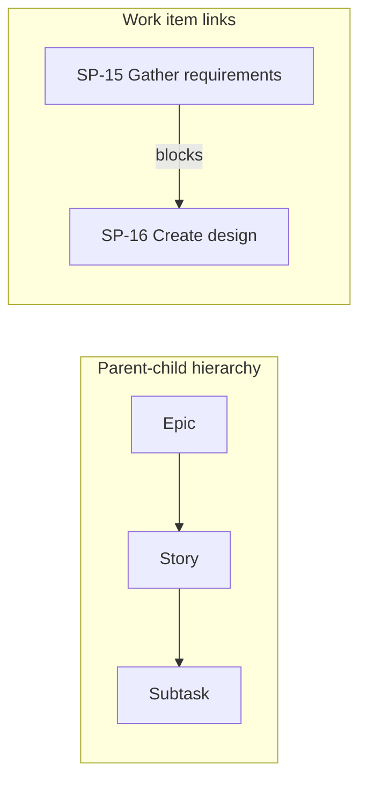

# Parent-Child Hierarchy vs Linked Work Items

[Course home](../README.md) › [Section 2: Jira Fundamentals](README.md) › Lesson 4 · 7:52

## TL;DR

Jira connects work in two different ways. **Parent-child hierarchy** places epics above stories, tasks, and bugs, with subtasks underneath. **Work item links** express relationships such as blocking, duplication, or general relatedness between any two items. Hierarchy parents must share the same space management type (both company-managed or both team-managed), but links can cross management types and spaces. Subtasks cannot have child subtasks; the **Add** button on a subtask creates links, not deeper hierarchy.

## Key concepts

- **Parent-child hierarchy**: The built-in three-level structure: epic → story/task/bug → subtask. One parent per child; many children per parent.
- **Work item link**: A labeled relationship between two work items that does not change their hierarchy level. Used for dependencies, duplicates, clones, and loose relatedness.
- **Cross-space hierarchy**: In company-managed spaces, a story in one space can have an epic parent in another company-managed space. The same applies between team-managed spaces. Mixing team-managed and company-managed items in one hierarchy chain is not supported.
- **Blocks / is blocked by**: A directional dependency. If *Gather requirements* blocks *Create design*, design cannot proceed until requirements are done (by agreement, not automatic enforcement).
- **Clones / is cloned by**: One item was copied from another.
- **Duplicates / is duplicated by**: Two items represent the same underlying work.
- **Relates to**: A general association with no implied order or dependency.

## Hierarchy vs links

| | Parent-child hierarchy | Work item links |
|---|---|---|
| Purpose | Organize work into epic → item → subtask | Express dependencies and relationships |
| Direction | Fixed levels (epic, middle, subtask) | Typed pairs (blocks/blocked by, etc.) |
| Cross-space | Same management type only | Any spaces, any management type |
| Subtasks | Bottom level only; no sub-subtasks | Can link to any work item |



## How to do it in Jira

### Assign or change a hierarchy parent

1. Open a story, task, or bug.
2. Find the **Parent** field (or the parent control on the backlog card).
3. Select an epic from the list. In company-managed spaces, epics from other company-managed spaces may appear.
4. Save the change. The work item stays in its own space but may roll up to an epic elsewhere.

### Create a work item link

1. Open the work item that should express the relationship (for example the blocking item).
2. Select **Add** (or **Link**) and choose **Linked work item** (wording may vary).
3. Pick the **link type**, such as **blocks**.
4. Search for the target work item by key or summary (for example `SP-16`).
5. Confirm with **Link**. Open the other item to see the inverse relationship (**is blocked by**).

### What subtasks can and cannot do

- A subtask belongs to exactly one parent story, task, or bug.
- Opening a subtask shows an **Add** option, but it adds **linked** work items, attachments, or web links—not nested subtasks.
- Subtasks cannot be assigned as epic children; they sit under middle-level work types only.

## Examples

In the *Stamps and Points* demo, subtask **SP-15 Gather requirements** under *Create user account* **blocks** **SP-16 Create design**. Opening SP-16 shows it **is blocked by** SP-15. This tracks a sequencing dependency without changing either item's epic parent.

A story in the **SP** company-managed space could have a parent epic in another company-managed sample space. The story still lives in SP and appears on the SP backlog, but reporting rolls up to the external epic.

A company-managed story can link to a team-managed work item with **is blocked by**, even though their epics cannot share a hierarchy chain.

```sql
issue in linkedIssues("ABC-15", "blocks")
```

## Tips and pitfalls

- **Do not confuse parent with link.** Parent-child organizes the backlog tree. Links express "must finish first," "duplicate of," or "related to" without moving items between epics.
- **Watch for external epic parents.** A card may show an epic label from another space. That is valid in company-managed setups but can surprise teams during planning.
- **Management type must match for hierarchy.** A company-managed story cannot have a team-managed epic as its parent, and vice versa. Use links if cross-type relationships are needed.
- **Links are not enforced gates.** *Blocks* documents dependency; Jira does not automatically prevent status changes on the blocked item unless workflow rules are added later.

> [!WARNING]
> Mixing team-managed and company-managed work items in one parent-child chain is not supported. Plan shared epics within one management type, or use links across types.

## Review questions

<details>
<summary>What is the difference between a parent-child relationship and a work item link?</summary>
Parent-child is the fixed epic → story/task/bug → subtask hierarchy with one parent per child. Links are typed relationships such as blocks or relates to between any work items, without changing hierarchy level.
</details>

<details>
<summary>Can a company-managed story have an epic parent in a different space?</summary>
Yes, if that epic is also in a company-managed space. The story remains in its own space but rolls up to the external epic for hierarchy.
</details>

<details>
<summary>Can you create a subtask under another subtask?</summary>
No. Subtasks are the bottom hierarchy level. The Add button on a subtask creates links or attachments, not nested subtasks.
</details>

<details>
<summary>If work item A blocks work item B, what appears on B?</summary>
B shows it is blocked by A. The relationship is stored as a pair of inverse link types.
</details>

<details>
<summary>Can links connect team-managed and company-managed work items?</summary>
Yes. Link types such as blocks and relates to work across management types and spaces. Only parent-child hierarchy requires matching management types.
</details>

## Related

- [Glossary](../reference/glossary.md)
- [Jira Terminology Changes](../reference/jira-terminology-changes.md)
- [Understanding Jira Work Types & Hierarchy](02-work-types-and-hierarchy.md)
- [Link-Based and Hierarchy JQL Queries for Advanced Filtering](../05-filters-and-jql/05-link-and-hierarchy-jql.md)

---

Previous: [Create Work Items: Epics, Stories & Subtasks](03-create-epics-stories-subtasks.md) · Next: [Understanding Jira Boards: Scrum, Kanban & Filters](05-boards-scrum-kanban-filters.md)
