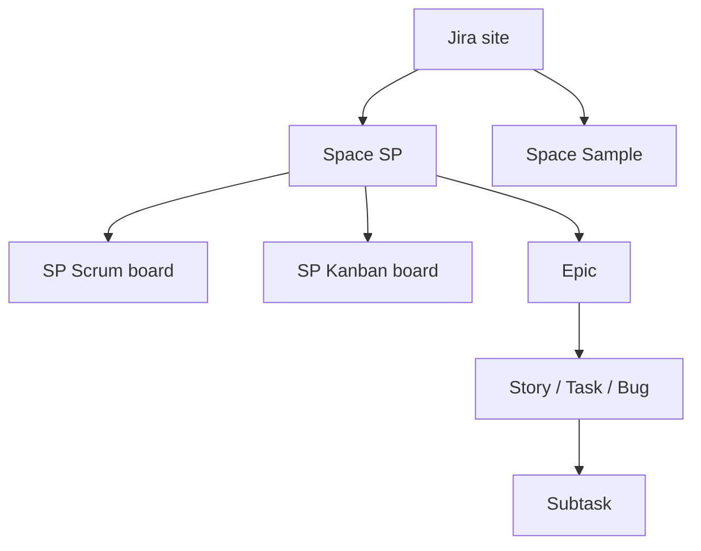

# How Jira Is Structured: Spaces, Boards & Work Items

[Course home](../README.md) › [Section 2: Jira Fundamentals](README.md) › Lesson 6 · 4:00

## TL;DR

A Jira **site** holds one or more **spaces**. Each space contains **work items** and can have multiple **boards** that display those items in different ways. Work items follow a default **hierarchy** (epic → story/task/bug → subtask) and can also connect through **links**. Boards are optional views; deleting or adding a board never removes underlying work. This lesson ties the section together so navigation among spaces, boards, epics, and individual work items feels predictable.

## Key concepts

- **Site**: The whole Jira Cloud instance for an organization (`name.atlassian.net`). Most companies run one site.
- **Space (formerly *project*)**: A container for related work with its own key, boards, and backlog. May be team-managed or company-managed.
- **Board**: A lens on work items. Often created with a space but can combine items from several spaces via filters.
- **Work item detail view**: The full screen for one item—summary, description, fields, comments, history, subtasks, and links.
- **Breadcrumb trail**: Links at the top of a work item that jump between the item, its epic parent, and the space.
- **Epic label on cards**: On the board and backlog, epics often appear as colored tags on story cards rather than as full cards in the main list.



## How to do it in Jira

1. **Find your site**: You are always inside one Jira site after signing in. The address bar shows `your-site.atlassian.net`.
2. **Open a space**: Use **Spaces** in the sidebar. Pick the space (for example **Stamps and Points App**, key **SP**).
3. **Switch boards**: Within a space, use the board switcher to move between Scrum, Kanban, or other boards tied to that space.
4. **Move between backlog and sprint views** on a Scrum board: use the space navigation tabs **Backlog** and **Active sprints**.
5. **Open one work item**: Click a card or search by key (for example `SP-12`). Use breadcrumbs to jump to the parent epic or back to the space.
6. **Show epics explicitly**: On the backlog, open the **Epics** panel when you need the full epic list instead of only the colored tags on cards.
7. **Trace hierarchy**: From a story, follow breadcrumbs to the epic and review its child list, or expand subtasks on the story detail view.

## Examples

A typical *Stamps and Points* setup after this section:

| Layer | Example |
|---|---|
| Site | One free practice site |
| Spaces | SP (company-managed main), a team-managed sandbox, optional sample spaces |
| Boards | SP Scrum board, SP Kanban board filtered to selected epics |
| Epics | User account, Collecting points, Shop registration, … |
| Stories | Create user account (under User account epic) |
| Subtasks | Gather requirements, Create design (under the story) |

On the Scrum backlog, *Create user account* shows a colored **User account** epic tag. Opening the story reveals subtasks and any **blocks** links to other items. The same story appears on both Scrum and Kanban boards when its status or filter matches.

```sql
project = ABC ORDER BY created DESC
```

## Tips and pitfalls

- **Spaces hold data; boards hold views.** When work seems "missing," check whether the board filter or sprint scope hides it before assuming it was deleted.
- **Epics are tags until you open the panel.** Small epic labels on cards are normal; use the Epics panel for epic-level planning.
- **Mixed space types on one site.** Team-managed and company-managed spaces coexist. Options and hierarchy rules differ slightly between them.
- **One item, many boards.** Editing on any board updates the single underlying work item.

## Review questions

<details>
<summary>What is the relationship between a site, a space, and a board?</summary>
A site is the whole Jira instance. Spaces are containers of work inside the site. Boards are views that display work items from one or more spaces.
</details>

<details>
<summary>Does deleting a board delete work items?</summary>
No. Boards only change how work is displayed. Work items remain in their space.
</details>

<details>
<summary>How do epics usually appear on the Scrum backlog?</summary>
Often as colored labels on story cards. The full epic list is in the Epics panel, separate from the main backlog cards.
</details>

<details>
<summary>How can you navigate from a story to its epic?</summary>
Open the story and use the breadcrumb trail at the top, or follow the parent/epic field in the detail view.
</details>

## Related

- [Glossary](../reference/glossary.md)
- [Jira Terminology Changes](../reference/jira-terminology-changes.md)
- [Scrum vs Kanban](../reference/scrum-vs-kanban.md)
- [Navigate Jira: Menus, Spaces & Settings](../01-introduction/05-navigate-jira-menus-spaces-settings.md)
- [Team-Managed vs Company-Managed Spaces](01-team-managed-vs-company-managed-spaces.md)

---

Previous: [Understanding Jira Boards: Scrum, Kanban & Filters](05-boards-scrum-kanban-filters.md) · Next: [Section 2 Quiz](07-section-2-quiz.md)
