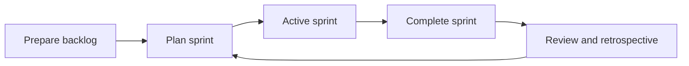

# Scrum Workflow in Jira: Sprints, Planning, and Execution

[Course home](../README.md) › [Section 3: Agile in Jira: Scrum and Kanban](README.md) › Lesson 1 · 12:06

## TL;DR

Scrum organizes work into short iterations called **sprints**, usually two weeks long. In Jira, a Scrum board supports the full cycle: prepare and prioritize the backlog, plan a sprint with a goal, start it, move work items (formerly *issues*) across the board day by day, then complete the sprint and send unfinished work back to the top of the backlog. The lesson walks through this simple version of Scrum on the *Stamps and Points* space.

## Key concepts

- **Scrum**: An Agile framework that breaks delivery into fixed-length sprints. Each sprint starts with planning, includes daily standups, and ends with review and retrospective before the next cycle begins.
- **Sprint**: A time-boxed iteration, typically two weeks, during which the team commits to a set of backlog work items and tracks them on the active sprint board.
- **Sprint goal**: A short statement of the most important outcome for the sprint—for example, launching an MVP of the loyalty app.
- **Backlog**: The ordered list of work not yet in an active sprint. Prioritized items sit at the top so the team always plans from what matters most.
- **Sprint planning**: The meeting (and Jira workflow) where the team selects backlog items, sets dates and a goal, and starts the sprint.
- **Complete sprint**: The action that closes the active sprint, removes done items from the board view, and moves incomplete items to a destination you choose.



## How to do it in Jira

1. Open the **Scrum board** for your space and switch to the **Backlog** view.
2. **Prepare the backlog**: make sure work items have enough detail (description, attachments, acceptance criteria) and are prioritized. Open the **Epics** panel to filter by epic and focus on the highest-priority epics first.
3. **Prioritize quickly**: right-click a work item and choose **Move work item to top of backlog** or **Move work item to bottom of backlog**. You can also drag items to reorder. Focus on getting important items to the top rather than ranking every item perfectly.
4. **Create or open a sprint**: click **Create sprint** if none exists. Drag work items from the backlog into the sprint, or bulk-select with **Shift** (range), **Ctrl**/**Cmd** (individual items), or checkboxes, then move them together.
5. **Set sprint details**: add start and end dates (two weeks is common—the end date may auto-fill), enter a **Sprint goal**, and click **Update**.
6. Click **Start sprint** and confirm. The **Active sprints** board now shows committed work items and subtasks.
7. During the sprint, drag cards across columns (**To Do**, **In Progress**, **Done**, or other statuses your workflow defines) as work progresses.
8. At sprint end, click **Complete sprint**. Done items leave the board view but remain searchable. For incomplete items, choose **Top of backlog** rather than moving them straight into the next sprint—this encourages fresh planning each cycle.
9. Create the next sprint from the backlog and repeat.

## Examples

On the *Stamps and Points* backlog, the team filters the **User account**, **User management**, and **Shop registration** epics and moves high-priority stories such as *Create user account* and *Sign up for business account* to the top. Lower-priority items like *Delete account* go to the bottom.

They plan **Sprint 1** with a goal of *Launch MVP for the app*, set a two-week date range, and start the sprint. Mid-sprint, some stories reach **Done** while others stay **In Progress**. At completion, unfinished stories return to the **top of backlog** for the next planning session—not automatically rolled into Sprint 2.

To find completed sprint work later:

```sql
project = ABC AND sprint = "Sprint 1" AND status = Done
```

## Tips and pitfalls

- **Prioritize epics before stories** when the backlog is large. Filter the epic panel, rank the epics that matter this cycle, then pull only related work items into the sprint.
- **Do not micro-rank every backlog item** before planning. Items at the bottom may never be picked; spend planning time on what is in front of the team.
- **Move incomplete work to the top of backlog**, not directly into the next sprint. Rolling unfinished items forward every sprint creates inertia and weakens re-commitment during planning.
- **An empty active board is normal** before the first sprint starts—the board shows the current sprint, and none is active yet.

> [!TIP]
> Bulk-select the first and last work item in a contiguous list with **Shift**, or pick scattered items with **Ctrl** (Windows) or **Cmd** (Mac), then drag them into the sprint in one move.

## Review questions

<details>
<summary>What happens to work items marked Done when you complete a sprint?</summary>
They disappear from the active board view but are not deleted. You can still find them with search or JQL.
</details>

<details>
<summary>Where should incomplete work items go when a sprint ends, and why?</summary>
To the top of the backlog. Starting each sprint from a fresh selection helps the team rethink goals instead of automatically carrying unfinished work forward.
</details>

<details>
<summary>What is a sprint goal used for?</summary>
It states the most important outcome the team aims to deliver during the sprint, such as launching an MVP version of the product.
</details>

<details>
<summary>How can you quickly raise several important backlog items without dragging each one?</summary>
Right-click each item and choose Move work item to top of backlog, or filter by epic, select the important items, and move them up. Drag-and-drop also works for fine-tuning order afterward.
</details>

<details>
<summary>How long is a typical sprint in the lesson's example?</summary>
Two weeks. The end date often appears automatically once you set the start date.
</details>

## Related

- [Glossary](../reference/glossary.md)
- [Scrum vs Kanban](../reference/scrum-vs-kanban.md)
- [Understanding Jira Boards: Scrum, Kanban & Filters](../02-jira-fundamentals/05-boards-scrum-kanban-filters.md)
- [Create Work Items: Epics, Stories & Subtasks](../02-jira-fundamentals/03-create-epics-stories-subtasks.md)
- [Estimating with Story Points and Time in Agile Projects](02-estimating-story-points-and-time.md)

---

Previous: [Section overview](README.md) · Next: [Estimating with Story Points and Time in Agile Projects](02-estimating-story-points-and-time.md)
