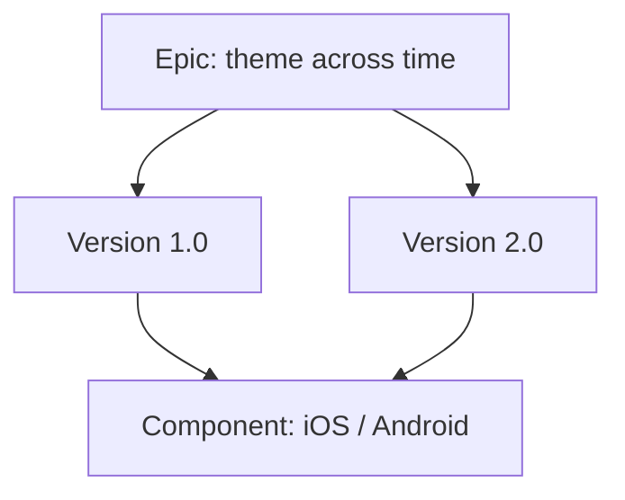

# Planning and Releasing with Versions in Jira

[Course home](../README.md) › [Section 4: Organizing Your Work](README.md) › Lesson 3 · 8:09

## TL;DR

**Versions** (also called **fix versions** or **release versions**) plan which work ships in each software release. Assign them on work items (formerly *issues*) or drag items onto a version in the **Versions** panel on the backlog. **Releasing** a version marks it complete, moves unresolved work elsewhere, and can generate **release notes**. One epic often spans several versions; versions slice the same theme across time.

## Key concepts

- **Version**: A named target release (for example `1.0`, `1.1`, `2.0`) with optional start date, release date, description, and driver (owner).
- **Fix version**: The field on a work item that records which version will include that work. The UI may say **Fix versions**, **Versions**, or **Release version**.
- **Versions panel**: A backlog sidebar (like the Epics panel) listing versions. Click a version to filter the backlog or drag work items onto a version to assign them.
- **Release**: An admin action that marks a version as shipped. Unfinished work items can be moved to another version or left unresolved.
- **Release notes**: An auto-generated summary of work completed in the version, editable before publishing.
- **Version progress**: In space settings, each unreleased version shows how many work items are To Do, In Progress, and Done.

## How epics, versions, and components fit together



An epic such as *Social activity* on *Stamps and Points* might start with login in version 1.0, avatars in 1.1, and comments in 2.0. Components can still split that work by platform within each version.

## How to do it in Jira

### Create a version from a work item

1. Open a work item and find **Fix versions** (under **More fields** if hidden).
2. Choose **Create version** (wording may vary).
3. Enter a name (for example `1.0`), optional dates, driver, and description, then save. The work item is assigned to that version.

### Use the Versions panel on the backlog

1. Open **Backlog** and enable the **Versions** panel from the toolbar (same area as the Epics panel).
2. Create additional versions (for example `1.1`, `2.0`, `Wishlist`) from the panel if needed.
3. Click a version to filter the backlog, or drag a work item onto a version to set its fix version.

### Show fix versions on cards

1. Open **Board settings** from the board menu (**⋯**).
2. Go to **Layout** / **Card layout** and add **Fix versions** (or **Versions**) under **Backlog**.
3. Save. Cards display their target release.

### Release a version (space admin)

1. Open **Space settings** > **Versions** (admin access required on many sites).
2. Find the version (for example `1.0`), open the menu (**⋯**), and choose **Release**.
3. If unresolved work items remain, choose a target version (for example move them to `2.0`) or ignore them.
4. Set the **Release date** and optionally **Generate release notes**.
5. Edit release notes (format, include description or environment, filter by work type) and confirm. The version shows as released.

### Track completion

1. In **Space settings** > **Versions**, view the progress bar for unreleased versions.
2. Hover to see counts of work items in To Do, In Progress, and Done.

Other admin actions on a version include **Merge**, **Edit**, and **Delete**.

## Examples

On *Stamps and Points*, stories for the first public launch get fix version **1.0**. Nice-to-have ideas get **Wishlist**. After shipping 1.0, the admin releases it; one unfinished story moves to **2.0**. When a story in 2.0 reaches Done, the 2.0 progress bar updates in space settings.

JQL for everything targeted at the next major release:

```sql
fixVersion = "2.0" AND project = ABC ORDER BY status
```

JQL for all work still planned for an unreleased version:

```sql
fixVersion = "1.0" AND project = ABC AND status != Done
```

## Tips and pitfalls

- **Naming varies in the UI.** The same concept appears as version, fix version, or release version depending on screen age and customization. They refer to the same planning field in JQL (`fixVersion`).
- **Releasing with open work is allowed.** Jira prompts where to send unresolved items; the lesson demonstrates moving them to the next version rather than blocking the release.
- **Release notes reflect completed work.** Items not in Done (or otherwise configured as complete) may not appear in generated notes — empty releases produce little content.
- **Versions panel vs card field.** Assigning via drag-and-drop on the panel sets fix version even when the backlog cards do not show the field until you add it in card layout.

> [!IMPORTANT]
> **Space settings > Versions** and the **Release** action are often limited to space admins or project leads. On a practice site you usually have full access; on a company site you may only assign fix versions on work items.

## Review questions

<details>
<summary>What is the difference between an epic and a version?</summary>
An epic groups work by theme or feature. A version groups work by target release date. One epic commonly spans multiple versions as features ship incrementally.
</details>

<details>
<summary>What happens when you release a version that still has unresolved work items?</summary>
Jira asks which version should receive the unfinished items, or whether to leave them unresolved. You set a release date and can generate release notes for completed work.
</details>

<details>
<summary>What JQL field name do you use for versions even when the UI says Fix versions?</summary>
<code>fixVersion</code> (for example <code>fixVersion = "1.0"</code>).
</details>

<details>
<summary>How can you assign a fix version without opening each work item?</summary>
Open the Versions panel on the backlog and drag work items onto the target version, or click a version to filter and bulk-edit if your permissions allow.
</details>

<details>
<summary>Where do you see progress toward completing a version?</summary>
In Space settings under Versions, each unreleased version shows a progress indicator based on work item statuses (To Do, In Progress, Done).
</details>

## Related

- [Glossary](../reference/glossary.md)
- [Create Work Items: Epics, Stories & Subtasks](../02-jira-fundamentals/03-create-epics-stories-subtasks.md)
- [Structuring Work with Components in Jira Projects](02-components.md)
- [JQL Basics: What is Jira Query Language and Why It Matters](../05-filters-and-jql/03-jql-basics.md)

---

Previous: [Structuring Work with Components in Jira Projects](02-components.md) · Next: [Creating Templates and Reusable Tasks for Efficiency](04-templates-and-reusable-tasks.md)
