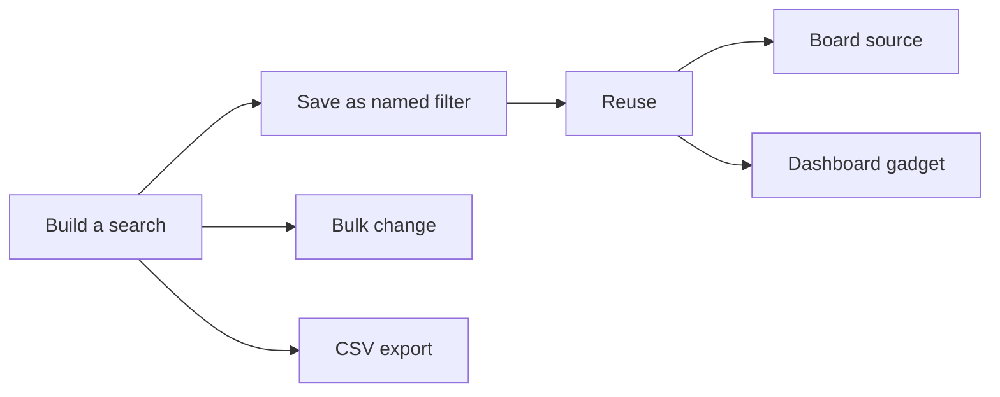

# Creating and Saving Filters in Jira for Quick Access

[Course home](../README.md) › [Section 5: Filters and JQL](README.md) › Lesson 2 · 10:31

## TL;DR

A saved filter stores a search so you can reopen it from **Filters**, attach it to boards and dashboards, and share it with others. Filter results are also a workspace for bulk changes — transition many work items at once, clear fields, export to CSV, or import from a spreadsheet. Set sharing and editor permissions when you save so the right people can view or change the filter.

## Key concepts

- **Saved filter**: A named, reusable search. The JQL (or basic-search criteria) is stored so you do not rebuild it every time.
- **Filter sharing**: Controls who can **view** the filter. Share with your organization (or a group) if the filter will power a shared board or dashboard; keep it private for personal views.
- **Filter editors**: Controls who can **change** the JQL. Restricting editors to yourself protects complex filters from accidental edits.
- **Bulk change**: An operation on every work item in the current filter results — transition workflow, edit fields, delete, or watch/unwatch.
- **Export filter fields**: Exports only the columns visible in the results table, which keeps CSV files manageable.



## How to do it in Jira

1. Build a search in basic mode or JQL until the results list shows the work items you want.
2. Customize columns: open the column picker and add fields you need (for example **Labels**, **Components**, **Fix versions**) so you can review or export them.
3. **Bulk change** (optional): select work items (or **Select all**), open the **More actions (⋯)** menu, choose **Bulk change work items** (formerly *Bulk change*), pick an operation, and confirm. For workflow moves choose **Transition**; for clearing metadata choose **Edit** and set fields to **Clear field**. Uncheck **Send email** unless recipients should be notified.
4. **Save the filter**: select **Save as** or **Save filter**, give it a short name (for example *SP stories* for all stories in the *Stamps and Points* space), set **Viewers** (organization, group, or private), set **Editors** (usually only you for fragile queries), and confirm.
5. **Reopen later**: go to **Filters** in the sidebar and select the saved filter from the list.
6. **Reuse on a board**: when creating a board, choose the advanced option and pick **Filter** as the source, then select your saved filter.
7. **Export**: open the **⋯** menu on the results, choose **Export**, pick **CSV** or **Excel CSV**, and prefer **Export filter fields** over **All fields** unless you truly need every column.
8. **Import** (advanced): export from one site, edit the CSV, and import through Jira's import tool to create work items on another site. Treat this as a last resort — duplicates and data loss are easy.

## Examples

Reset demo data in the *Stamps and Points* space (`ABC`): find stories that were moved out of **Open**, then bulk-transition them back.

```sql
project = ABC AND issuetype = Story AND status != Open
```

After the list appears, bulk-select them, choose **Transition**, and move all to **Open**. Refresh — the filter should return zero results because nothing matches *status != Open* anymore.

Save a permanent view of all stories in the space:

```sql
project = ABC AND issuetype = Story ORDER BY rank ASC
```

Name it *SP stories*, share view access with your organization if teammates need it, and keep edit access private.

Bulk **Edit** with **Clear field** on **Labels**, **Components**, and **Fix versions** removes metadata from every selected work item in one step — useful after demo exercises.

## Tips and pitfalls

- **Uncheck send email on bulk updates.** Each work item can trigger a notification to watchers. Updating dozens of items without disabling email can spam the team.
- **Transition vs Move vs Edit.** **Transition** changes workflow status. **Move** relocates work to another space or changes work type. **Edit** updates field values. Pick the operation that matches your goal.
- **Export filter fields, not all fields.** Exporting every Jira field produces huge files full of empty columns. Set up the columns first, then export.
- **Import and export carefully.** Moving data through Excel between Jira sites is powerful but error-prone. Prefer working inside Jira when you can.

> [!WARNING]
> CSV import can create duplicate work items if keys or summaries overlap. Test on a small file in a practice site before importing hundreds of rows into a shared space.

> [!IMPORTANT]
> If a filter will power a team board or dashboard, share it at least with the organization (or the relevant group). A private filter other people cannot see will break shared gadgets that reference it.

## Review questions

<details>
<summary>What is the difference between filter viewers and filter editors?</summary>
Viewers can run the filter and see its results. Editors can change the JQL or criteria. Restrict editors when a filter is complex and easy to break.
</details>

<details>
<summary>When bulk-changing status, which operation should you choose — Transition, Move, or Edit?</summary>
Transition. It moves work items through the workflow to a new status. Move relocates work to another space or changes work type; Edit updates field values without necessarily changing status.
</details>

<details>
<summary>Why export filter fields instead of all fields?</summary>
Filter fields exports only the columns shown in the results table. All fields includes every Jira field, many of them empty, which makes the file large and hard to work with.
</details>

<details>
<summary>How can a saved filter become the source for a new board?</summary>
When creating a board, choose the advanced or filter-based option and select the saved filter. The board then shows work items matching that filter's JQL.
</details>

## Related

- [Glossary](../reference/glossary.md)
- [JQL Cheat Sheet](../reference/jql-cheat-sheet.md)
- [Using Basic Search and Quick Filters in Jira](01-basic-search-and-quick-filters.md)
- [Understanding Jira Boards: Scrum, Kanban & Filters](../02-jira-fundamentals/05-boards-scrum-kanban-filters.md)
- [Creating Personal and Team Dashboards in Jira](../08-dashboards-and-reports/01-personal-and-team-dashboards.md)

---

Previous: [Using Basic Search and Quick Filters in Jira](01-basic-search-and-quick-filters.md) · Next: [JQL Basics: What is Jira Query Language and Why It Matters](03-jql-basics.md)
