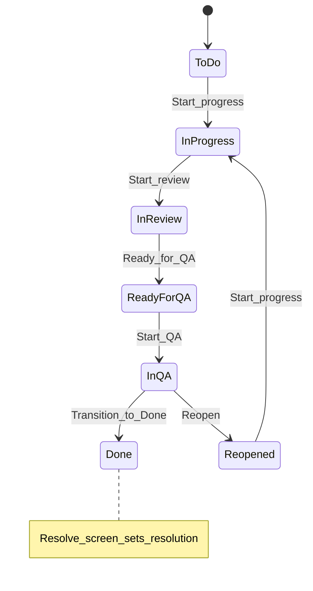

# Navigating Complex Workflows Without Getting Lost in Jira

[Course home](../README.md) › [Section 6: Projects, Boards, Workflows, and Statuses](README.md) › Lesson 3 · 12:56

## TL;DR

Complex workflows add many statuses, named transitions, transition screens, and automated **post functions**—mostly configured by Jira administrators. Watching how a custom workflow is built explains why everyday users see limited choices at each step and why closing work sometimes opens a form. A practical review path is: open **View workflow**, note allowed transitions from the current status, and ask an admin when a move is missing or blocked. Keep new workflows simple and add rules gradually so the team is not overwhelmed.

## Key concepts

- **Named transition**: The label users click to move work—for example **Start review**—which may differ from the destination status **In review**.
- **Orphan status**: A status with no incoming transitions (shown as unconnected on the editor until a transition targets it).
- **Global transition to Done**: A shortcut allowing closure from any status, often paired with a **Resolve issue** screen.
- **Transition screen**: A form shown during a transition, commonly used to pick **Resolution**, add comments, or capture time spent.
- **Workflow scheme**: Links workflows to spaces and work types (formerly *issue types*). Publishing a scheme change applies the workflow to matching work items.
- **Condition**: A rule that must be true before a transition is offered—for example only the assignee may move the item.
- **Validator**: Checks input during the transition—for example a required comment.
- **Trigger**: Starts an automatic action tied to the transition (for example a DevOps event).
- **Post function**: An action Jira runs after a successful transition—update status, reindex, fire notifications, assign a user, call a webhook, and more.
- **Reopened status**: A distinct status showing work returned after review or QA, separate from a brand-new **To Do** item.

## Example workflow structure

The lesson builds a linear review-and-QA path with an escape hatch to Done and a loop back from QA:

## How to do it in Jira

### Explore a complex workflow as a user

1. Open a work item and click **Status** > **View workflow**.
2. Locate the current status on the diagram and follow outgoing arrows—those are the transitions available to you.
3. Try the status dropdown on the work item; it should list the same allowed moves (sometimes using transition names).
4. If a move is missing, check whether the workflow intentionally limits paths—for example only **Start review** from **In progress**, not a direct jump to **Done** unless a global Done transition exists.

### What administrators configure (observe or follow along)

1. **Settings** (gear) > **Work items** > **Workflows** > **Create workflow** (exact labels can vary).
2. Add statuses—reuse existing ones when possible—and assign each to a category (**To Do**, **In Progress**, or **Done**).
3. Draw transitions between statuses and name them clearly (**Start progress**, **Start QA**, and so on). Reuse transition names when the same move applies from multiple sources (for example **Start progress** from both **To Do** and **Reopened**).
4. Optionally allow **all statuses to transition** to **Done** for emergency closure.
5. Edit a transition to attach a **screen** (for example **Resolve issue**), plus optional conditions, validators, triggers, and extra post functions.
6. Assign the workflow through a **workflow scheme** to a space and work types, then **Publish** so live work items pick up the new paths.

### Close work through a resolve screen

1. From **In QA**, choose the transition to **Done** (or use a global Done transition if configured).
2. Complete the **Resolve issue** screen: pick **Resolution** (**Done**, **Won't Do**, **Duplicate**, **Cannot reproduce**, and others your admin defined), add comments, and fill any required fields.
3. After submit, the status becomes **Done** and **Resolution** is stored permanently—it generally cannot be edited afterward.

### When transitions fail or confuse you

1. Reopen **View workflow** and read conditions on the transition arrow.
2. Ask the space owner or Jira administrator which permissions or field values are required.
3. Prefer simple workflows for new teams; add conditions, screens, and automation only when a clear process need exists.

## Examples

On a company-managed sample space, a story in **To Do** offers only **Start progress** and **Transition to done**—not every status on the diagram. After **Start progress**, only **Start review** and **Done** appear, enforcing a review gate.

From **In QA**, testers can **Reopen** when bugs are found—moving work to **Reopened** rather than back to generic **To Do**, signalling the item was worked on before. **Start progress** from **Reopened** sends it to **In progress** again.

Closing with resolution **Won't Do** and a comment explaining the decision leaves the item in **Done** status with **Won't Do** resolution visible on the work item—distinct from successfully completed work.

Default post functions on every transition include updating status, recording history, reindexing the work item, adding any transition comment, and firing a generic event notifications can listen for. Admins may add post functions that assign the work item to the current user or trigger external webhooks.

## Tips and pitfalls

- **Transition name ≠ status name.** Users click **Ready for QA** while the item lands in the **Ready for QA** status—similar words, different roles in the workflow.
- **Screens slow closure on purpose.** Resolve screens capture why work stopped; skipping them requires admin changes, not a user workaround.
- **Resolution is permanent.** Treat resolution choice carefully; mistaken **Won't Do** or **Duplicate** values usually need admin help to fix.
- **Publish before testing.** Workflow scheme changes apply only after publishing; until then, work items follow the old workflow.
- **Complexity has a cost.** Many conditions and post functions confuse newcomers—introduce them after the team is comfortable with basic statuses and transitions.

> [!IMPORTANT]
> If a transition behaves unexpectedly—wrong assignee, missing option, or silent failure—inspect the workflow with an administrator. The cause is often a condition, validator, or post function on that specific transition.

> [!TIP]
> When requesting workflow changes, describe the team process in plain language ("QA finds a bug and sends work back to development") rather than listing status names. Admins can map that story to statuses, transitions, and screens.

## Review questions

Why does a work item in To Do show only Start progress and Done, even though the workflow diagram has many statuses?

Workflows limit which transitions are valid from each status. The dropdown and board moves show only outgoing transitions from the current status—not every status in the diagram.

What is the purpose of a Reopened status instead of moving failed QA work back to To Do?

Reopened signals the item was previously worked on and returned after review or testing, separating it from brand-new work that has never started.

What happens on the Resolve issue screen when transitioning to Done?

The user selects a resolution (Done, Won't Do, Duplicate, Cannot reproduce, etc.), may add comments or time spent, and submits. The status becomes Done and the resolution is stored permanently.

Name three default post functions Jira runs after a successful transition.

Any three of: update the work item's status, add a transition comment to the history, update change history, reindex the work item, and fire a generic event for notifications or automation.

What must an administrator do after assigning a new workflow in a workflow scheme?

Publish the workflow scheme change so work items in the affected space and work types start using the new statuses and transitions.

## Related

- [Glossary](../reference/glossary.md)
- [Workflow States and Transitions: What You Can See and Do](02-workflow-states-and-transitions.md)
- [What to Do When Statuses Don't Match Across Teams](../07-cross-team-collaboration/04-mismatched-statuses-across-teams.md)
- [When to Ask Admins for Help with Jira Automation](../09-automation/04-when-to-ask-admins.md)

---

Previous: [Workflow States and Transitions: What You Can See and Do](02-workflow-states-and-transitions.md) · Next: [Section 6 Quiz](04-section-6-quiz.md)
