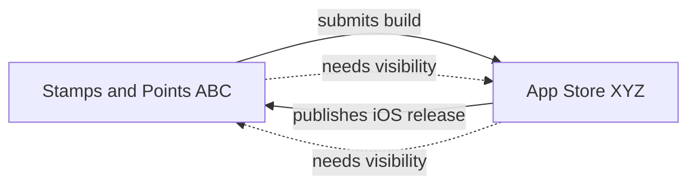

# Managing Cross-Team Work in Jira: Best Practices

[Course home](../README.md) › [Section 7: Cross-Team Collaboration](README.md) › Lesson 1 · 4:33

## TL;DR

Real products often need more than one team in Jira. The *Stamps and Points* loyalty app team builds features in sprints, but a separate App Store management team handles publishing, compliance, and release coordination for every mobile app the company ships. Each team tracks work in its own space (formerly *project*), yet both need enough visibility to spot dependencies and avoid blocking each other without drowning in each other's detail.

## Key concepts

- **Cross-team work**: Work that spans two or more teams or spaces, where progress in one place affects another.
- **Separate spaces, shared goal**: Each team keeps its own backlog, board, and workflow. Coordination tools sit on top — filters, shared boards, timelines, dashboards — rather than merging everything into one space.
- **Scoped visibility**: Partner teams usually care about a slice of work (one app, one release, one platform), not every work item (formerly *issue*) in the other team's space.
- **Dependency awareness**: You need to see when your team is waiting on another team, or when another team is waiting on you, without copying their entire backlog into yours.
- **Process plus tooling**: Jira boards and filters help, but regular sync conversations (planning, release check-ins) still matter for alignment.

## The Stamps and Points scenario

The course uses two spaces:

| Space | Role | How work is scoped to the app |
|---|---|---|
| *Stamps and Points* (`ABC`) | Builds the loyalty app in Scrum sprints | Normal backlog and sprint planning |
| App Store management (`XYZ`) | Publishes and maintains apps across the company | Label `SP app` on relevant work items; epic *Publish and release management* covers the first release |

The App Store team runs Kanban without sprints. Only a handful of their work items matter to the *Stamps and Points* team right now, but both sides need to know release timing, blockers, and progress on shared milestones.

## How to do it in Jira

This lesson sets up the problem; the next lessons show concrete Jira setups. Before choosing tools, clarify:

1. **What each team owns** — development vs publishing, iOS vs Android, etc.
2. **What subset the other team needs to see** — a release version, a component, a label, or an epic.
3. **What "blocked" means** — linked work items, waiting on a build, waiting on store approval, and so on.
4. **How often teams sync** — sprint planning, release planning, or a standing cross-team standup.

Then pick one or more views: a saved filter and shared board, a timeline with dependencies, a dashboard gadget, or linked work items between spaces. The course walks through filters and boards next, then timelines and status mapping.

## Examples

Midway through sprint 4, the *Stamps and Points* team finishes an iOS build and hands it to App Store management. The App Store team tracks compliance checks and store listing updates under epic *Publish and release management*, all tagged `SP app`. Developers want to know whether store submission is on track; the App Store team wants to see which iOS features land in the next release without reading every story in sprint 4.

Neither team should add the other's entire backlog to their sprint. They should agree on a release (for example version `3.2.0`), mark relevant work on both sides, and build a shared view that shows only that slice.

## Tips and pitfalls

- **Do not merge backlogs by default.** Keeping spaces separate preserves each team's workflow and permissions. Share a filtered view instead of moving foreign work items into your sprint.
- **Tag early, tag consistently.** Labels, components, and fix versions are cheap coordination hooks. Decide naming (for example `SP app`) before work spreads across dozens of items.
- **Balance transparency and noise.** Partner teams need release-level and dependency-level visibility, not every subtask in your sprint.

> [!TIP]
> Before opening Jira, sketch who needs to see what and how often. The right filter or board follows from that agreement; the tool alone does not create alignment.

## Review questions

Why do the Stamps and Points and App Store teams keep separate Jira spaces instead of one shared space?

Each team has different workflows, backlogs, and ownership. App Store management handles many apps company-wide; the development team runs Scrum sprints. Separate spaces keep daily work clean while coordination happens through shared views and process.

How does the App Store team mark work that belongs to the Stamps and Points app?

They add the label SP app to relevant work items. In the course demo, the publish-and-release epic and related tasks use that label so filters can pull only app-specific work from the App Store space.

What do both teams need from each other besides shared Jira views?

Enough visibility to spot dependencies and blockers, awareness of release timing and scope, and regular alignment so neither team is surprised by the other's plans — without sharing every low-level task.

Should the development team add App Store work items to its active sprint?

Only if both teams agree during shared planning. Adding another team's work items to your sprint without that agreement breaks sprint ownership and makes scope hard to manage.

## Related

- [Glossary](../reference/glossary.md)
- [Planning and Releasing with Versions in Jira](../04-organizing-work/03-versions-and-releases.md)
- [Using Issue Labels and Priorities to Organize Work in Jira](../04-organizing-work/01-labels-and-priorities.md)
- [Creating and Using Shared Boards for Team Collaboration](02-shared-boards.md)

---

Previous: [Section overview](README.md) · Next: [Creating and Using Shared Boards for Team Collaboration](02-shared-boards.md)
