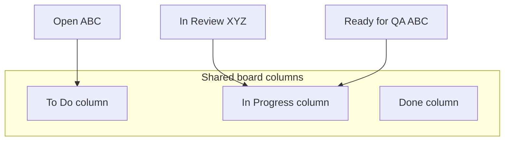

# What to Do When Statuses Don't Match Across Teams

[Course home](../README.md) › [Section 7: Cross-Team Collaboration](README.md) › Lesson 4 · 5:32

## TL;DR

When a shared board pulls work items from spaces with different workflows, **unmapped statuses** can make cards vanish from the board and even from the backlog on Scrum boards. Map every foreign status to a column under **Board settings > Layout > Columns**. For searches and dashboards that must treat "in progress" the same everywhere, filter on **status category** instead of status name so *In Progress*, *In Review*, and *Ready for QA* all match.

## Key concepts

- **Unmapped status**: A workflow status that is not assigned to any column on the board. Work items in that status do not appear on the board view.
- **Workflow mismatch**: Each space can define its own statuses. *To Do* and *Open* may align, but mid-flow statuses like *In Review* or *Ready for QA* may exist in only one workflow.
- **Status category**: Jira groups every status into **To Do**, **In Progress**, or **Done**. Categories are stable across workflows even when status names differ.
- **Ongoing column maintenance**: Each time you add a space to a shared filter or board, re-check column mapping — new workflows bring new statuses.
- **Backlog visibility on Scrum boards**: On a Scrum board, unmapped statuses can hide work items from the backlog as well as the active sprint columns.

## How to do it in Jira

### Fix disappearing work items on a shared board

1. Open the cross-team release board and notice missing App Store (`XYZ`) items even though the filter still finds them in **Search work items**.
2. Go to **Board settings** > **Layout** > **Columns** (wording may be **Columns and statuses**).
3. Review **Unmapped statuses** — statuses from foreign workflows with no column assignment.
4. Drag each unmapped status into the appropriate column (for example map *In Review* and custom progress statuses to **In Progress**).
5. Return to the board and backlog; previously hidden cards should reappear.

Repeat this check whenever a new space joins the shared filter.

### Query by status category for cross-team views

When a dashboard or filter should list "everything actively being worked on" regardless of status name:

1. Open the saved release filter (for example *Release of version 3.2.0*).
2. Wrap the existing OR query in parentheses and add a **status category** condition that applies to both sub-queries:

```sql
(
  (
    (project = ABC AND fixVersion = "3.2.0" AND component = iOS)
    OR
    (project = XYZ AND fixVersion = "3.2.0" AND labels = "SP app")
  )
  AND statusCategory = "In Progress"
)
ORDER BY rank ASC
```

3. Run the query — results include *In Progress*, *In Review*, *Ready for QA*, and any other status whose category is **In Progress**, even if the board columns use different labels.

Use `"To Do"` or `"Done"` similarly when you need open or completed work across workflows.

## Examples

The shared `3.2.0` release board showed six App Store work items, then only two after the App Store team moved items into *In Review* — a status that existed in the App Store workflow but was unmapped on the development team's board columns. Mapping *In Review* to **In Progress** restored the missing cards in the backlog.

For a dashboard gadget "Active release work," status-based JQL like `status = "In Progress"` misses App Store items in *In Review*. Status category catches both:

```sql
(
  (
    (project = ABC AND fixVersion = "3.2.0" AND component = iOS)
    OR
    (project = XYZ AND fixVersion = "3.2.0" AND labels = "SP app")
  )
  AND statusCategory in ("To Do", "In Progress")
)
```

Adding a third space with its own workflow later introduces new statuses — column mapping and category-based filters keep the shared view honest.



## Tips and pitfalls

- **Vanishing cards mean unmapped statuses first.** Before blaming the filter, open column settings and look for unmapped statuses from the other space's workflow.
- **Map by meaning, not spelling.** Put foreign *In Review* in the **In Progress** column because both mean active work, even if the column title says *In Progress*.
- **Status category for reporting; columns for daily board use.** Boards need explicit mapping. Filters and dashboards can use `statusCategory` to abstract away naming differences.
- **More spaces, more statuses.** A shared board that grows from two spaces to four will accumulate unmapped statuses unless someone audits columns after each addition.

> [!CAUTION]
> On Scrum boards, unmapped statuses can remove work items from the backlog view, not just from sprint columns. Teams may think work was deleted when it is only unmapped.

> [!IMPORTANT]
> Parentheses matter in JQL: wrap the full OR block before adding `AND statusCategory = ...` so the category filter applies to work items from every space in the filter.

## Review questions

<details>
<summary>Why did App Store work items disappear from the shared board even though the filter was unchanged?</summary>
The App Store workflow uses statuses such as In Review that were not mapped to any column on the shared board. Unmapped statuses hide work items from the board and can hide them from the Scrum backlog too.
</details>

<details>
<summary>Where do you map foreign statuses onto shared board columns?</summary>
Board settings, then Layout (or Columns and statuses), then Columns. Drag unmapped statuses into the column that matches their meaning.
</details>

<details>
<summary>Why use statusCategory instead of status in a cross-team filter?</summary>
Each space can use different status names for the same kind of work. Status category groups them into To Do, In Progress, or Done so one query catches every team's active work.
</details>

<details>
<summary>When should you re-check column mapping?</summary>
Whenever you add a new space to a shared filter or board, or when a team introduces new workflow statuses — unmapped statuses accumulate over time.
</details>

<details>
<summary>How should parentheses be arranged when adding statusCategory to an OR filter?</summary>
Wrap the entire OR expression in parentheses, then AND the status category outside that block so both sub-queries must match the category condition.
</details>

## Related

- [Glossary](../reference/glossary.md)
- [Workflow States and Transitions: What You Can See and Do](../06-boards-and-workflows/02-workflow-states-and-transitions.md)
- [Customizing Your Jira Board View Without Admin Access](../06-boards-and-workflows/01-customizing-board-view.md)
- [Creating and Using Shared Boards for Team Collaboration](02-shared-boards.md)
- [Useful JQL Examples for Real Work: Practical Use Cases](../05-filters-and-jql/06-useful-jql-examples.md)

---

Previous: [Roadmaps in Jira: Visualizing Plans and Dependencies](03-roadmaps-plans-and-dependencies.md) · Next: [Section 7 Quiz](05-section-7-quiz.md)
