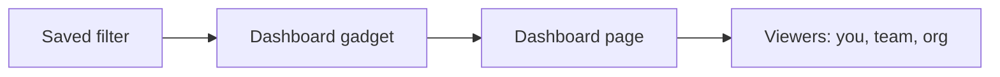

# Creating Personal and Team Dashboards in Jira

[Course home](../README.md) › [Section 8: Dashboards and Reports](README.md) › Lesson 1 · 4:37

## TL;DR

A **dashboard** is a customizable page of **gadgets** that pull live data from Jira—often from saved filters—so you can share progress without rebuilding slides every week. Every Scrum or Kanban board already has a built-in **Summary** view with premade charts; dashboards let you combine exactly the gadgets, layout, and audience you need. Create one from **Dashboards**, pick a column layout, add and configure gadgets, then keep it private or share it with your organization.

## Key concepts

- **Dashboard**: A page made of gadgets. You choose the layout, which gadgets appear, and who can view or edit it.
- **Gadget**: A small widget on a dashboard—charts, lists, activity feeds, and more. Most reporting gadgets need a saved filter as their data source.
- **Board Summary**: A premade dashboard on each board showing status breakdowns, epic progress, and recent activity. Useful out of the box; not customizable like a personal dashboard.
- **Dashboard layout**: The column structure (one, two, or three columns, with optional wide/narrow splits). Gadgets can be dragged between columns after you add them.
- **Viewers and editors**: Sharing settings that control who can open the dashboard and who can change its gadgets and layout. Restricting **Editors** to yourself protects a team dashboard from accidental edits.

## How to do it in Jira

1. For a quick board-level view, open a space board and select **Summary** in the board menu. Review the premade charts before building something custom.
2. To create a custom dashboard, go to **Dashboards** in the sidebar (or the **Dashboards** menu) and select **Create dashboard** (the **+** button).
3. Enter a **Name** and **Description**. Set **Viewers** to private (only you) or share with your organization. Set **Editors**—the course recommends keeping editors limited to yourself unless someone else should maintain the layout.
4. Select **Add** (or **Create**) to open the empty dashboard.
5. Choose **Change layout** to pick column widths. Three equal columns work well on a large monitor; switch to fewer or wider columns if gadgets need more space.
6. Select **Add gadget**, search the gadget directory, and add the widgets you want. New gadgets land in the first column; drag them to other columns as needed.
7. Configure each gadget immediately: open its **Configure** (or **⋯**) menu, set filters, column lists, colors, item counts, and refresh options, then save.
8. When every gadget is configured, select **Done**. Use **Edit**, **Copy**, **Share**, or **Rename** from the dashboard toolbar to adjust permissions or duplicate the page later.

## Examples

A developer on the *Stamps and Points* loyalty app creates **My ABC dashboard** as a private page. They add **Activity Stream** (limited to five items) and **Filter Results** tied to a saved filter for the ABC board. They trim the results columns to **Key**, **Summary**, and **Status**, then drag both gadgets into a two-column layout.

A release lead builds **Version 3.2 status** with three columns: **Filter Results** spanning the left column, **Work item Statistics** and a **Pie Chart** in the middle, and **Created vs. Resolved Chart** on the right—all powered by one saved filter for the release.

## Tips and pitfalls

- **Configure every gadget after adding it.** Unconfigured gadgets may show blank panels until you attach a filter and save settings.
- **Prepare filters first.** Gadgets such as **Filter Results**, **Pie Chart**, and **Work item Statistics** cannot display meaningful data without a saved filter you own or can view.
- **Explore the gadget catalog.** Dozens of gadgets exist; the next lesson covers the most useful ones, but your space may need something different.
- **Refresh if a gadget looks empty.** After saving configuration, reload the dashboard or use the gadget's refresh control.

> [!TIP]
> Start with one saved filter and one simple gadget (for example **Filter Results**). Once that works, add charts rather than configuring many gadgets at once.

## Review questions

What is the difference between a board Summary view and a custom dashboard?

Summary is a fixed, board-level overview built into every board. A custom dashboard lets you pick gadgets, layout, filters, and sharing for any audience.

Why do many reporting gadgets require a saved filter?

The filter defines which work items the gadget counts or lists. Without it, the gadget has no dataset to display.

When should you restrict dashboard editors to yourself?

When you want to prevent others from rearranging gadgets, changing filters, or breaking a dashboard the team relies on—even if they can view it.

What happens to newly added gadgets before you drag them?

They appear in the first column by default. You drag them to other columns and configure each one separately.

## Related

- [Glossary](../reference/glossary.md)
- [Reports and Metrics](../reference/reports-and-metrics.md)
- [Creating and Saving Filters in Jira for Quick Access](../05-filters-and-jql/02-creating-and-saving-filters.md)
- [Navigate Jira: Menus, Spaces & Settings](../01-introduction/05-navigate-jira-menus-spaces-settings.md)
- [Useful Gadgets for Your Jira Dashboard: Filters, Charts, and More](02-useful-dashboard-gadgets.md)

---

Previous: [Section overview](README.md) · Next: [Useful Gadgets for Your Jira Dashboard: Filters, Charts, and More](02-useful-dashboard-gadgets.md)
