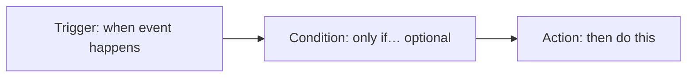

# What Can Be Automated in Jira by Non-Admins?

[Course home](../README.md) › [Section 9: Jira Automation](README.md) › Lesson 1 · 10:17

## TL;DR

Jira Automation lets you build rules that react to events in a space (formerly *project*) without writing code. A regular user who is a **space admin** can create and manage rules for that space only; a **Jira admin** can run rules across many spaces. Every rule has a **trigger** (when it runs), optional **conditions** (whether it runs), and **actions** (what it does). The lesson builds a rule that emails the assignee when a work item (formerly *issue*) is assigned to someone else, then adds a JQL condition to skip self-assignments.

## Key concepts

- **Jira Automation**: Built-in rule engine in Jira Cloud. Rules watch for events and perform actions such as sending email, transitioning status, or updating fields.
- **Space admin vs Jira admin**: A space admin manages one space and can automate within it. A Jira admin can create **global** rules that span multiple spaces.
- **Automation rule**: A named recipe made of a trigger plus one or more components (conditions, branches, actions).
- **Trigger**: The event that starts a rule, such as *Work item assigned* or *Work item created*.
- **Condition**: A gate that must pass before the next step runs. Common types include field checks and **JQL conditions**.
- **Action**: What the rule does when triggered and conditions pass, such as *Send email* or *Edit work item*.
- **Branch (For each)**: Applies actions to a set of related items, such as all subtasks of a parent work item.
- **Smart value**: A placeholder such as `{{issue.key}}` or `{{assignee.displayName}}` that Jira fills in with live data when the rule runs.
- **Rule owner**: The person responsible for the rule. Can receive error notifications if the rule fails.
- **Automation audit log**: A history of rule executions in **Space settings > Automation**, useful for confirming a rule fired and debugging failures.
- **Rule templates**: Pre-built recipes for common patterns such as syncing parent and child status, posting to Slack, or creating Confluence pages.
- **Plan limits**: Jira Cloud plans cap how many rule executions your site can use per month. Check **Usage** in the automation screen.

## Rule anatomy

Every automation rule follows the same structure:

Between the trigger and an action you can also insert **Then** (go straight to action), **If** (add a condition), or **For each** (branch over related items).

| Component | Role | Example |
|---|---|---|
| Trigger | Starts the rule | Work item assigned |
| If / condition | Limits when actions run | Assignee is not current user |
| Then / action | Performs the work | Send email to assignee |
| For each / branch | Repeats actions over a set | Every open subtask of the parent |

## How to do it in Jira

1. Open the space where you are a space admin (for example the *Stamps and Points* loyalty app space).
2. Go to **Space settings > Automation** (the transcript uses *Project settings*; the current label is **Space settings**).
3. Browse **Templates** for ready-made rules, or open **Rules** and select **Create rule**.
4. Choose a **trigger**. For the lesson demo, pick *Work item assigned* (or the equivalent *Work item assigned* label).
5. Select **Then** and add an **action**: *Send email*. Set the recipient to the assignee and compose the body.
6. Insert **smart values** from the `{…}` picker — for example assignee display name, work item key, and summary — so the email is dynamic.
7. Select **Next**, open **Rule details**, give the rule a clear name, optionally add a description, and turn the rule **On**.
8. Test by assigning a work item on the board and checking your inbox and the automation **Audit log**.
9. To refine the rule, edit it and add an **If** component with a **JQL condition** between the trigger and the action. JQL does not autocomplete here; test the query in **Filters** first, then paste it into the rule.

## Examples

### Assignee notification email

- **Trigger**: Work item assigned
- **Action**: Send email to assignee with body: `Hey {{assignee.displayName}}, work item {{issue.key}} ({{issue.summary}}) was assigned to you. Good luck!`

### Same rule with a self-assignment skip

- **Trigger**: Work item assigned
- **Condition (JQL)**: `assignee != currentUser()`
- **Action**: Send email as above

Only assignments made by someone other than the assignee trigger the email. When you assign work to yourself, the rule does not fire.

### Template ideas worth exploring

- When all subtasks are Done, transition the parent to Done (and the reverse).
- Clone a work item on creation.
- Create a Confluence page from a work item.
- Post to Slack when a work item transitions.

## Tips and pitfalls

- **Test before you enable.** Assign a work item, add a comment, or transition status deliberately to confirm the rule behaves as expected.
- **Understand the blast radius.** Rules that auto-close parents or children look helpful but can surprise teammates who did not know the rule existed. Introduce them only when the team understands Jira automation.
- **JQL in automation is strict.** The condition editor does not offer the same autocomplete as **Filters**. Build and validate the query in search first.
- **Check plan usage.** Heavy rules on busy spaces consume monthly execution quotas. Review **Usage** if rules stop running.

> [!WARNING]
> Auto-closing related work items — for example marking all subtasks Done when the parent closes — can hide work people still expect to do. Communicate new rules before turning them on in a shared space.

> [!TIP]
> Start from a **template** when the pattern matches your need. Templates show working trigger/condition/action combinations you can customize instead of building from scratch.

## Review questions

Who can create automation rules in a single space, and who can create rules that span multiple spaces?

A space admin can create and manage rules for spaces they administer. A Jira admin can create global rules that apply across multiple spaces.

What are the three main parts of an automation rule?

A trigger (when the rule runs), optional conditions (whether it runs), and actions (what it does).

Why did the lesson add a JQL condition with <code>assignee != currentUser()</code>?

To prevent the email action from firing when someone assigns a work item to themselves. The rule should notify other assignees, not the person doing the self-assignment.

Where can you verify that a rule ran after testing it?

In the automation audit log under Space settings > Automation, and by checking whether the expected outcome happened (such as receiving the email).

What is a smart value, and why use one in an email action?

A placeholder like <code>{{issue.key}}</code> that Jira replaces with live data when the rule runs. It keeps notification text accurate without hard-coding work item details.

## Related

- [Glossary](../reference/glossary.md)
- [Create Work Items: Epics, Stories & Subtasks](../02-jira-fundamentals/03-create-epics-stories-subtasks.md)
- [JQL Basics: What is Jira Query Language and Why It Matters](../05-filters-and-jql/03-jql-basics.md)
- [Smart Checklists: Creating Reusable Checklists in Jira Issues](02-smart-checklists.md)

---

Previous: [Section overview](README.md) · Next: [Smart Checklists: Creating Reusable Checklists in Jira Issues](02-smart-checklists.md)
