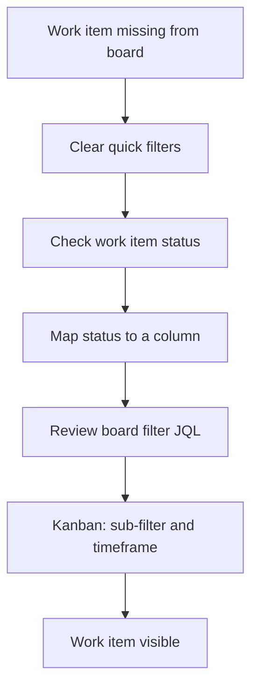

# Where's My Issue? Troubleshooting Visibility Problems in Jira

[Course home](../README.md) › [Section 10: Best Practices and Final Challenge](README.md) › Lesson 3 · 4:13

## TL;DR

A work item (formerly *issue*) that exists in Jira but is missing from a board is usually filtered out — not deleted. Work through board quick filters, status-to-column mapping, and the board's saved filter JQL in that order. On Kanban boards, also check the sub-filter and any time-window setting that hides older cards.

## Key concepts

- **Board quick filter**: A temporary narrowing of cards on the board (epic, version, assignee, and custom quick filters). Active filters can hide work items that still exist in the space.
- **Column mapping**: Which workflow statuses appear in which board column. A status with no column does not show on the board even though the work item is open.
- **Board filter**: The saved JQL query that defines which work items a board may display at all. Extra conditions (such as "component is empty") can exclude valid work items.
- **Kanban sub-filter**: An additional JQL layer on some Kanban boards (for example by fix version) that limits how much work appears.
- **Timeframe filter**: A Kanban setting that hides work items older than a chosen window (for example one or two weeks).

## Troubleshooting checklist

When a work item should be on the board but is not, check these in order:

1. **Board quick filters** — Clear epic, version, assignee, and any custom quick filters. Confirm the work item's epic is included if an epic filter is active.
2. **Work item status** — Open the work item and note its status. Compare with the board columns.
3. **Column mapping** — Go to **Board settings** > **Columns** (or **Layout**). Ensure the work item's status maps to a visible column; add or remap columns if a status is orphaned.
4. **Board filter JQL** — In **Board settings**, open the filter. Look for extra clauses (for example `component is EMPTY`) that exclude the work item. Edit, replace, or split into a new board if the filter is intentional but too narrow.
5. **Kanban-only: sub-filter** — Check the secondary filter (often tied to fix version) and relax it if it hides the work item.
6. **Kanban-only: timeframe** — Check whether a "last N weeks" window is hiding older work items.

## How to do it in Jira

### Step 1 — Rule out quick filters

1. Open the board where the work item should appear.
2. Open the **Epics** panel or epic quick filter and clear selections, or select the epic the work item belongs to.
3. Clear **Versions**, **Assignee**, and any other active quick filters.

### Step 2 — Fix status-to-column mapping

1. Open the work item in another view (search or **List**) and note its **Status** (for example *Testing*).
2. Open the board menu and choose **Board settings**.
3. Go to **Columns** and confirm that status appears in a column. Add the status to a column or create a new column if it is unmapped.
4. Save and refresh the board.

### Step 3 — Fix the board filter

1. In **Board settings**, locate the **Filter** used by the board.
2. Choose **Edit filter query** and read the JQL.
3. Remove or adjust clauses that exclude the work item (for example drop `component is EMPTY` if the item has a component).
4. **Save** the filter and **Save changes** on the board, then refresh.

### Step 4 — Kanban extras

1. In **Board settings**, find the **Sub-filter** (or secondary query) and the **Timeframe** option if present.
2. Widen or clear them, save, and refresh.

## Examples

Work item `SP-12` (*Sign up for business account*) belongs to epic `SP-6`. The board's epic quick filter hides every story except one epic, so `SP-12` disappears until all epic filters are cleared.

After clearing epics, `SP-12` still does not show. Its status is *Testing*, but the board columns only map *To Do*, *In Progress*, and *Done*. Adding *Testing* to a column surfaces the card.

It still fails the board filter: the saved JQL includes `component is EMPTY` while `SP-12` has component *Registration*. Removing that clause from the filter brings the work item back.

On a Kanban board, a two-week timeframe hides bugs finished earlier; widening the window shows them again.

## Tips and pitfalls

- **Search first to prove the work item exists.** If basic search finds it, the problem is board configuration, not deletion.
- **Orphan statuses are common after workflow changes.** Any new status needs an explicit column mapping on every board that should show it.

> [!WARNING]
> Editing a shared board filter affects everyone who uses that board. Confirm with the team before removing conditions that were added on purpose.

## Review questions

What is the first place to look when a work item vanishes from a Scrum board?

Active board quick filters — especially epic, version, and assignee filters.

Why can a work item be open but invisible on the board?

Its status may not be mapped to any board column, so the board has nowhere to render it.

What does <code>component is EMPTY</code> in a board filter do?

It excludes any work item that has a component set, even if the work item otherwise matches the space.

Which extra checks apply on Kanban but not necessarily on Scrum?

The sub-filter (often by fix version) and a timeframe window that hides older work items.

## Related

- [Glossary](../reference/glossary.md)
- [Understanding Jira Boards: Scrum, Kanban & Filters](../02-jira-fundamentals/05-boards-scrum-kanban-filters.md)
- [Customizing Your Jira Board View Without Admin Access](../06-boards-and-workflows/01-customizing-board-view.md)
- [Using Basic Search and Quick Filters in Jira](../05-filters-and-jql/01-basic-search-and-quick-filters.md)

---

Previous: [Jira Etiquette: Do's and Don'ts for Real Teams](02-jira-etiquette.md) · Next: [Final Challenge: Apply What You've Learned in Jira](04-final-challenge.md)
